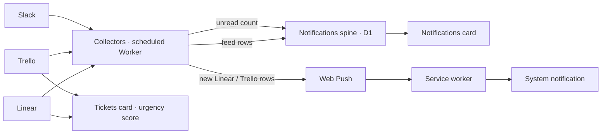
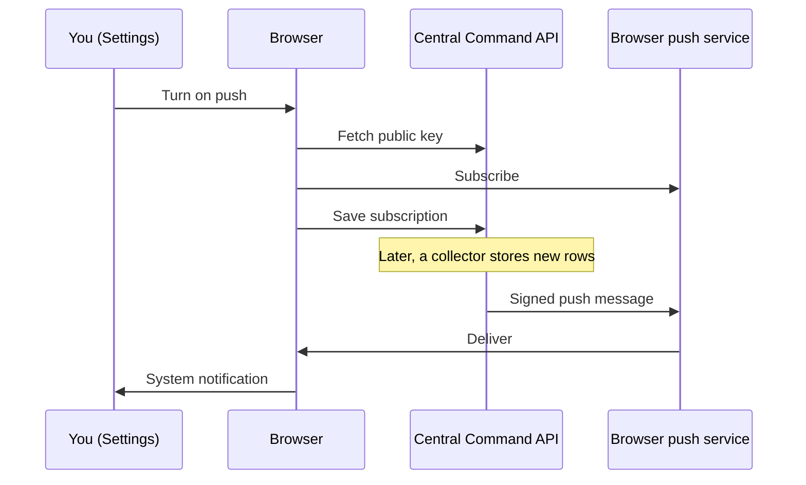

# A Tap on the Shoulder: Alerts, Urgent Tickets, and Push for Central Command

## The Problem With a Dashboard

[Central Command](/blog/central-command) is a dashboard, and a dashboard has one
big weakness: it only works while you're looking at it. If the tab is closed, or
buried behind twenty others, the dashboard can know something important and
still have no way to tell you.

In late August we gave it the
[homelab heartbeat](/blog/central-command-homelab-integration) and a
**notifications spine**: one place where every unread thing should land,
so the count can be driven to zero. That spine had exactly one producer, the
homelab. This round, three pieces of work landed together, each tracked as its
own epic:

- **More sources:** Linear, Slack, and Trello now feed the spine.
- **An urgent-tickets card:** a short "what needs you right now" list across
  Linear and Trello.
- **An installable app with push:** Central Command can be installed like a
  native app and can send notifications while it isn't open.

Together they let the dashboard tap you on the shoulder instead of waiting to be
checked.

## More Voices Into the Spine

The spine was designed for this moment. It's a single `notifications` table with
a plain-text `source` column, so adding a source means adding a collector, not
changing the database schema. A second table keeps one row per source with an
optional unread count, which matters because not every source behaves the same.

That split between **feeds** and **counts** decided how each new source plugged
in:

| Source | Shape      | What lands in the spine                                                       |
| ------ | ---------- | ----------------------------------------------------------------------------- |
| Linear | Feed       | Your notifications: assigned, mentioned, new comment, status change, due soon |
| Trello | Feed       | Unread card notifications: added to a card, mentions, comments, due soon      |
| Slack  | Count only | A single unread total across your conversations                               |

Slack is count-only on purpose. A busy workspace would flood the feed with rows
nobody wants to dismiss one at a time, so it reports one number and shows up as
a badge, the same way the spine was always meant to handle email.

A few things carried over from the homelab work without anyone needing to
remember them:

- **Sanitising at the choke point.** Every producer goes through the same
  append function, which strips control characters and caps lengths. The new
  collectors got that for free.
- **Duplicates are expected.** Each row is keyed by the producer's own id, and
  inserts ignore anything already stored, so re-reading the same notifications
  is harmless.
- **Silence is not health.** A source that stops reporting for more than 24
  hours is now marked **stale** by the scheduled job. It's the same rule as the
  homelab card's offline warning, one level down.

Each account is added from a Connections area in Settings. Credentials are
stored encrypted, multiple accounts per provider are supported, and each
collector is rate-gated through KV so it can't hammer a provider's API.

## The Urgent-Tickets Card

Notifications tell you what _happened_. The new **Tickets** card answers a
different question: of everything assigned to me in Linear and Trello, what
actually needs attention now?

It isn't a board view. Each ticket gets an **urgency score** from two inputs,
priority and how close the due date is, and only tickets that clear a threshold
are shown:

| Priority    | When it surfaces                               |
| ----------- | ---------------------------------------------- |
| Urgent      | Always                                         |
| High        | Always, ranked higher once it's due or overdue |
| Medium      | Only when due within three days, or overdue    |
| Low or none | Only when due within a day, or overdue         |

The card sorts by score, not by date, so a high-priority ticket with no due date
still outranks a low-priority one due tomorrow. That ordering was the main
design goal: priority wins, and deadlines only promote the things you'd
otherwise safely ignore.

The two providers express priority differently. Linear has a priority field,
which maps across directly. Trello doesn't, so the card reads card labels named
"urgent", "critical", "high", "medium", or "low", and treats an unlabelled card
as medium.

When nothing clears the bar, the card says **All clear** instead of hiding
itself. A card that's still there and empty is information too. The result is
cached for five minutes, and long lists clip with a "more" note so the card
always fits its tile.

## Leaving the Tab: An Installable App With Push

The last piece is what makes the shoulder tap possible. Central Command is now
a **Progressive Web App**: a website that the browser can install like a native
app, with its own icon and window.

That took three parts:

1. **A web app manifest** with the name, theme colour, regular and maskable
   icons, and `display: standalone`, so the installed app opens in its own
   window without browser chrome. Settings shows an **Install app** button
   whenever the browser offers installation.
2. **A hand-written service worker.** It caches the app shell when it installs,
   serves page loads from the network with the cached shell as a fallback, and
   lets API calls go straight to the network. When the network is down, API
   calls get a clear "offline" response instead of hanging.
3. **Web Push.** In Settings you can turn on push notifications. The browser
   creates a subscription, the API stores it against your account, and from
   then on the server can reach that device directly. The service worker shows
   the notification, and tapping it focuses an open Central Command window or
   opens a new one.

We considered a Vite PWA plugin and wrote the service worker by hand instead.
The worker is short, and the push handling is the part that mattered, so owning
it outright was simpler than configuring around a plugin. The server side added
no dependencies either: the signed token that push services require is
generated with the Web Crypto API that Cloudflare Workers already provide.

Push is fed by the spine. When the Linear or Trello collector stores new rows,
it sends one push summarising how many arrived, with the first one as the body.
If the server isn't set up for push, the collectors skip it and everything else
keeps working.

## What It Doesn't Do Yet

Some deliberate gaps, so nobody reads more into this than shipped:

- **Not every source pushes.** Only new Linear and Trello rows trigger a push.
  Slack is a count, so there's nothing discrete to announce, and homelab alerts
  still reach the phone through the lab's own alerting rather than through
  Central Command.
- **Collectors run on the existing scheduled job,** whose timing is still a
  placeholder. The tap on the shoulder is only as quick as that schedule, and
  tightening it is the obvious next step.
- **Urgency thresholds are fixed in code.** Making them adjustable per user was
  planned, but they ship as constants until real use shows where they should
  sit.
- **No Gmail.** Reading unread mail needs a restricted Google permission that
  triggers Google's app verification, so it waits until the public demo's setup
  is settled.
- **Placeholder icons.** The first installable build used temporary icons. The
  proper brand mark replaced them the next day.

The dashboard used to be something you went and looked at. Now, for the things
that matter most, it can come and find you.
