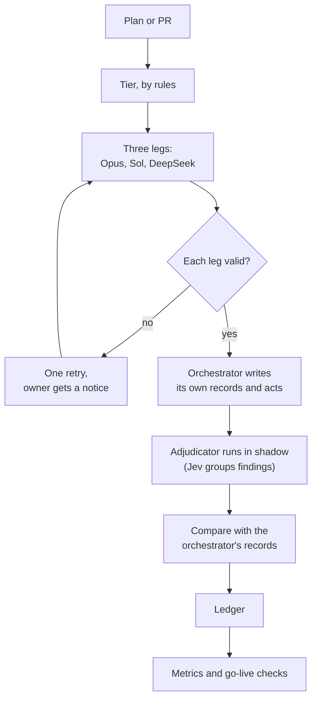

# Teaching the Audit to Decide: Jev and Audit Autonomy, Phase A

The [triple audit](/blog/triple-audit) put every plan and every pull request in front of three
independent reviewers from three model families: Opus 5.5, DeepSeek V4 Pro and the latest Codex Sol.
It does what it was built for. Three families catch different blind spots, and a single reviewer
inherits the writer's assumptions.

It also has a cost, and the cost isn't mainly tokens. Every disagreement between legs came back to
me as a question. Every unconverged round meant another full round. This post covers **Phase A** of
the follow-up: an effort to let the audit settle routine outcomes by itself, without losing the defects
it exists to catch. As of 6 November it runs **in shadow**. It records what it would have done,
next to what was actually done, and nothing has been admitted yet.

Three threads:

1. What the triple audit costs, measured.
2. What Phase A built, and where the judge, Jev, fits.
3. How shadow data, not opinion, decides what goes live.

## Part 1: What three auditors cost

Before building anything, the archive of past audits was frozen as a baseline, so later numbers
compare against fixed data rather than a moving one. Re-running the frozen scripts gives:

- **575 audited targets**, with a mean of **1.43 full rounds** per target.
- **20 pauses with an explicit question** to me.
- A median of **342 seconds** of leg wall time per target, over the 250 targets with leg timings.

The round count was set as a target: at most 1.3 full rounds per target. That number matters more
than it looks. A second full round means all three legs read the whole change again, usually to
confirm one fix.

The planning of Phase A was itself an example of the problem. The first plan audit came back NO-GO
from all three legs. The second came back split (two GO-WITH-FIXES, one NO-GO), and under the rule at
the time, two unconverged rounds went to me. My answer was to split the work into phases, and the
plan for Phase A was approved on 4 November after a third round.

Phase A's stated aim, from the policy document: remove the owner pauses and repeated full rounds that
audits cause, **without losing defect detection**, and collect the data the next phase needs.

## Part 2: What Phase A built

### Code decides, Jev answers one question

**Jev** is a judge model. You send it a state and typed questions, and it returns structured answers
with probabilities: a yes/no question returns P(yes). That shape suits a narrow role well, because
the code can decide what a probability is worth.

In Phase A, Jev answers exactly one question: **are these two findings the same underlying claim?**
Everything else (the tier, the decision on each finding, the gates) is decided by code and policy.

### The pieces

The work landed in waves:

- **Pre-work.** The old verify gate was removed, and the baseline above was frozen.
- **T1: the policy.** One JSON policy file, a schema for it and a human-readable document. If the
  document and the JSON disagree, the JSON wins and the document is the bug. A checklist script
  checks the JSON against the schema and against every rule in the document that can be checked
  statically, such as the decision table cell by cell.
- **T2: the read guard and a bulk reader.** A hook stops full reads of files over 350 lines by the
  main session and general-purpose agents, so bulk reading goes to a cheaper, read-only reader.
- **T3: three command-line tools.** One adjudicates findings, one computes the tier, and one computes
  the metrics.
- **T4: wiring.** The adjudicator runs inside the audit skill, in shadow.
- **T6: pointers.** One line in each repo's own `CLAUDE.md` points at the policy, so a session in any
  repo finds it.
- **T5: the staged go-live.** It waits for the shadow window to close.

### Flags that fail safe

Each new capability sits behind its own flag, and each flag is `off`, `shadow` or `live`. Every flag
shipped as `shadow`.

The important rule is what happens when something breaks: **anything that cannot be read counts as
`off`.** A missing policy file, a file that fails its schema, a missing flag and an unknown value all
mean today's behaviour. A broken policy can never switch a capability on.

### Tiers and always-owner items

Every target gets a tier, computed by rules alone with no model involved:

| Tier   | When                                                                                                                                 |
| ------ | ------------------------------------------------------------------------------------------------------------------------------------ |
| High   | Control files, migrations, destructive commands, secrets paths, auth, money or CI/infra patterns, a deleted test or fewer test cases |
| Low    | Docs only, or only added tests, outside every High pattern, and at most 150 changed lines                                            |
| Medium | Everything else                                                                                                                      |

A plan is never Low, and a tier only ever moves up. The patterns lean broad on purpose: matching too
much only raises a tier, while matching too little lets a risky change drop out of High.

Some changes always need me, however the audit goes: security-policy changes, destructive actions,
production changes and a few others. I approve the item itself, once, and the findings on that
target then follow the normal rules. Merges that deploy to production ask me only when the change is
High tier.

### The adjudicator

Each auditor writes its findings in a fixed one-line format next to its numbered prose. A leg whose
prose and finding lines don't match one-to-one is invalid, which closes a gap where a critical could
be written only in prose and never reach a finding line.

The adjudicator then works in three steps:

1. **Group findings, only to count votes.** Candidate pairs come from different legs whose locations
   overlap, or that share a symbol or section. Jev gets one batched question per audit, at most 40 pairs. Only a trusted yes (a
   probability of at least 0.80) links a pair. Unsure answers and failures stay separate.
2. **Keep every member whole.** Each finding in a group keeps its own claim, evidence and
   disposition, and a group is finished only when every member is. A wrong link can change a vote
   count, but it cannot make a defect disappear.
3. **Decide per group**, from a fixed table.

| Severity | Reported by        | Confirmed                                           | Refuted                                                | Inconclusive           |
| -------- | ------------------ | --------------------------------------------------- | ------------------------------------------------------ | ---------------------- |
| Critical | Any number of legs | Fix                                                 | Closes only after a cross-provider recheck confirms it | Escalate               |
| Warning  | Two or three legs  | Fix                                                 | Closes only after a recheck confirms it                | Escalate               |
| Warning  | One leg            | Fix                                                 | Close as refuted, with the evidence                    | Recheck, then escalate |
| Note     | Any                | Apply the repo's convention, or defer with a reason |                                                        |                        |

"Confirmed" and "refuted" come from verification: the claim is checked against the cited code, an
invariant or a test, and the evidence is recorded before anything is fixed. A critical is never
dismissed automatically, and escalations for one target reach me as one consolidated question, never
one per finding.

### Targeted rechecks instead of full rounds

The other half of the cost was the second full round. Phase A replaces it with a **targeted
recheck**: the legs review only the delta since the last audited head, plus the findings it
addresses. A **coverage chain** then says a target passes at its latest head only when a full audit
covers the first head and a passing recheck covers every delta since, with nothing else changed.

Escalation thresholds replace the old "two rounds, then ask" rule: two repair cycles per finding, or
three full rounds per target. They never waive an audit.

### A ledger for everything

Each audit keeps an append-only ledger: the policy version and exact model IDs, the tier and why,
the raw leg outputs, every Jev request and response, every decision and who made it, fix commits,
owner questions and approvals, and tokens per leg. The policy version is written on every line, so
any decision can be traced to the rules it ran under, and replayed.

## Part 3: Shadow decides what goes live

### Order matters

In shadow, the orchestrator first writes its own grouping and decision records from the raw legs,
and acts on them exactly as before. Only then does the adjudicator run. The ledger's timestamps prove
the order, which keeps the reference independent of the thing being measured.

### The window and the bar

The shadow window lasts until **at least 20 audited targets, at least 8 of them with a non-GO leg**,
capped at 30 days. That cap falls on 4 December. A flag without enough data at the cap stays in
shadow, and I'm told.

Each flag then goes live on its own evidence:

| Flag               | Goes live when                                                                                             |
| ------------------ | ---------------------------------------------------------------------------------------------------------- |
| Grouping and notes | Grouping agrees at least 90% with the orchestrator's, and no critical is mis-grouped                       |
| Warnings           | Warning dispositions agree at least 90%, and the adjudicator never closed a warning the orchestrator fixed |
| Refuting criticals | At least 3 shadowed refutations, all confirmed by a cross-provider recheck                                 |
| Rechecks           | Every shadowed coverage chain held                                                                         |
| Merge              | At least 5 shadow merge decisions match the actual ones                                                    |

Going live is not one-way either. A live flag drops back to shadow automatically, with a notice, if
an auto-fix commit is reverted within 14 days, a refuted critical is later confirmed, a merged PR is
reverted for a defect the audit had seen, or an escape is logged against an audit.

The metrics tool counts the things that would show lost detection directly: criticals closed without
a cross-provider recheck, reverted auto-fixes, and escapes. Any cost saving only counts when all
three are zero in the same window.

### What shadow has already shown

Running in shadow paid off before anything went live.

- **The live test worked.** A real full audit of the wiring change followed the new skill end to
  end. The orchestrator's records came before the first adjudicator run in the ledger, groupings
  agreed, and the gates correctly said that this merge would have asked me under the new policy.
- **The first real Jev call disagreed with me.** On one pair I had merged two findings; Jev answered
  P(yes) = 0.32 and kept them apart. It cost $0.00002, and it is now one data point on the grouping
  flag, not a decision.
- **Jev was barely being asked.** In the first sessions after the restart, Jev failed in 3 of 5 audits
  because a safety scan read long file paths as possible keys, and one hit cancelled the whole call.
  Across 7 archived audits, Jev was called once, and that call asked about 0 pairs. Without shadow,
  that would have looked like Jev agreeing with everything.

### Fail closed beats patching patterns

One lesson from building the tools is worth recording. A rule that parsed the auditors' free text
for answer phrases kept leaking one new phrasing per audit round, for four rounds. Each fix covered
the last phrasing and missed the next. The fix that converged flipped the rule: any line with a
blocking severity word is always checked as a finding, and answers must use fixed forms that contain
no severity word. Fail-closed rules plus structured output beat a growing list of exceptions.

## What comes next

Phase A gives the system a way to measure itself. The shadow window collects the evidence, and T5
switches flags on one at a time, only where the data clears the bar.

**Phase B** is planned on Phase A's data: routing each audit to the level it needs (no audit, Sol
alone or the full triple), evaluating cheaper auditors, and a Jev question at the merge gate. Like
everything in Phase A, each piece starts in shadow and is admitted only on eval evidence. After that
comes the **Trailhead phase**, applying the same rules and flows to the orchestrator that turns
tickets into reviewed pull requests.

## Why this matters

Three auditors made defects harder to miss. They also made me the slowest step. Phase A doesn't
trade one for the other: code decides, a judge answers one narrow question, every decision is in a
ledger, and nothing is automated until the shadow data shows it would have made the same call.
