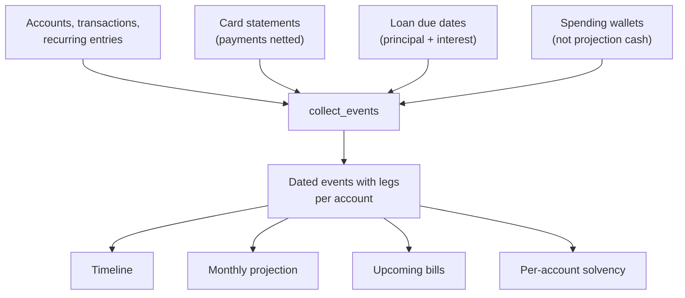
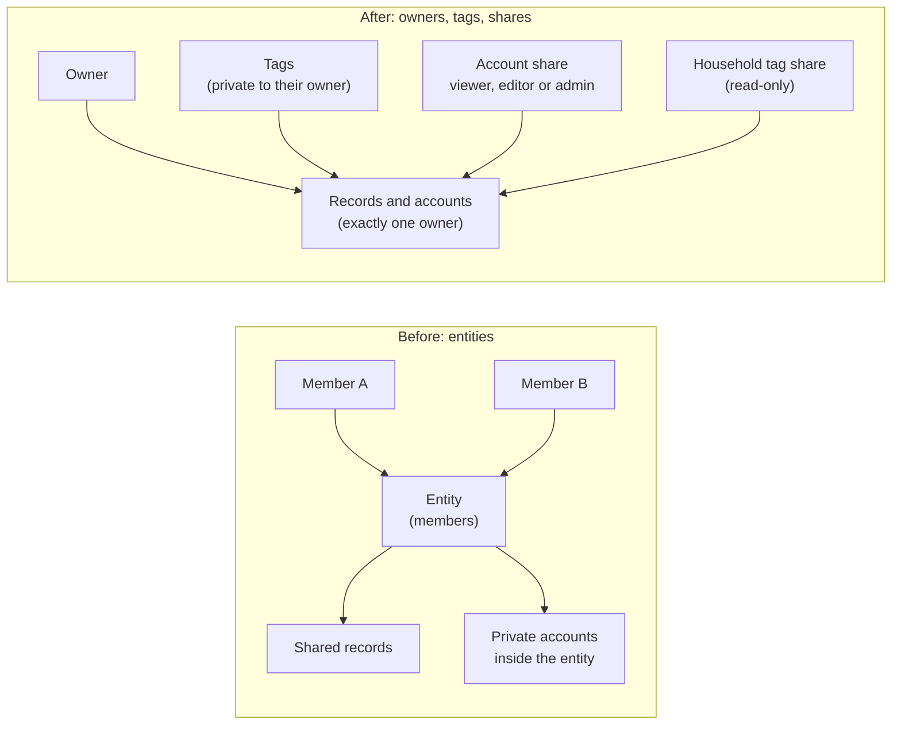
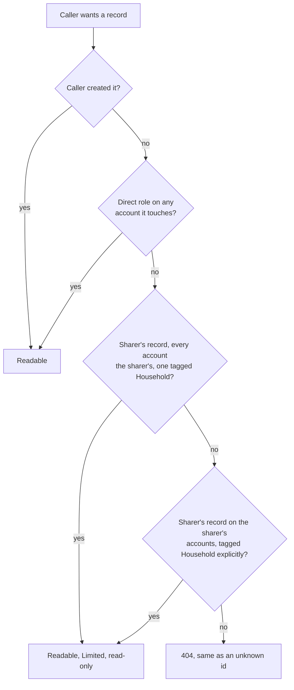
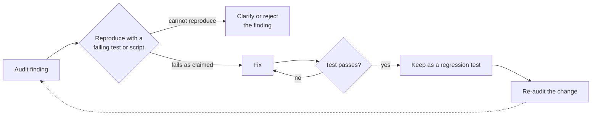

# From Entities to Owners: Reworking Tally & Trace

Two earlier posts covered the forecaster's first rebuilds: a
[day-ordered running balance](/blog/tallyandtrace-update) that could see the mid-month trough,
and [per-account solvency](/blog/tallyandtrace-per-account-solvency) that routes each bill from a
primary account to an overflow account. This post covers what happened next in
[Tally & Trace](/work/tallyandtrace): a long rework that took the projection engine from
"one balance" to "every kind of money the app can hold," and then replaced the data-sharing model
underneath it.

Three threads, in order:

1. The rework itself, from the first engine rewrite to the move off entities.
2. Why multi-member **entities** were replaced, and what took their place.
3. How we proved each audit fix instead of assuming it.

## Part 1: One engine, many kinds of money

The rework started by deleting duplication. The timeline, the monthly projection and the
upcoming-bills list each had their own idea of what happens on a given day. They now all read from
a single dated-event engine, `collect_events`. Every event carries **legs**, one per account it
touches. A transfer from one cash account to another is `−(amount + fee)` on the source and
`+amount` on the destination, so a pooled total only moves by the fee.

That one structure is what let the later pieces slot in without special cases.

### Card statements

A credit card is not cash. A purchase becomes owed money, and cash only leaves when the statement
comes due. The engine derives one payable per billing cycle, then **nets payments against it**:

- A payment is any transfer into the card, posted or planned, early or late.
- Payments settle the oldest open statement first, and each payment is used once.
- A fully paid statement drops out, and a partly paid one shows the remainder.
- Refunds beyond a statement's charges carry forward as a credit, the same way an overpayment does.
- An unpaid statement from before the window is emitted at the window start, marked overdue and
  keyed by its original date, so two overdue statements for one card stay two events.

The bug this fixed was a good example of why netting matters: statements ignored transfers into the
card, so every closed cycle showed its full balance on its due date even after it had been paid.

### Spending wallets

Some accounts hold money that is already set aside to spend: a cash envelope, an e-wallet. Counting
them as projection cash makes the forecast optimistic, because that money is spoken for. A
**spending wallet** is therefore excluded from projection cash, and money moved into one counts as
spent at top-up. Wallet spending is still shown by category in the period summary, offset by an
"unallocated wallet spend" row so the rows always sum to the total. Money moved back out of a wallet
shows as a negative "returned from wallets" row. Recurring transfers arrived in the same step, so a
top-up can be scheduled like any other bill.

### Loans

A loan payment is one transfer from the paying account to the loan: the transfer amount is
principal and the transfer fee carries the interest. The loan gets a schedule, payments made and
left, and a next due date. In the projection, loans are liabilities rather than cash:

- A due date that no transfer covers produces a payment leg on the loan's paying account.
- Posted payments settle due dates oldest first, and a due date counts as made only when it is
  fully paid.
- Planned payments cover what is left, and each unit of money leaves cash exactly once. A recurring
  payment pays its own due date first and only then carries forward. A one-off planned payment
  starts at the oldest open due date no more than about a month before its own date and carries
  forward from there, so a catch-up payment can settle an overdue instalment.

### The shape of the engine

By this point the engine was right for one person. The next problem was _who_ the engine was
computing for.

## Part 2: Why entities were replaced

Early on, Tally & Trace grouped records into **entities**: a named container with members. A person
could belong to several, and "shared" meant "visible to the entity's other members." It was the simplest answer to the first version of the question.

But it modelled sharing and ownership with the same object, and that turned into the source of most
of our audit findings. Inside one entity, some accounts were private to their creator and some were
shared, so every read and every write had to answer "is this the caller's, the entity's, or someone
else's private account that happens to sit in the same entity?" The leaks we kept finding all had
that shape: a hidden loan whose name surfaced in a projection label, a card-funding leg built for
an account the caller could not see, a co-member editing a transaction that moved a balance they
could not reach.

We stopped patching and replaced the model.

### The new model

- **Every record has exactly one owner.** There is no multi-member container any more.
- **Tags replace grouping.** A business grouping becomes a tag. A record can carry several tags,
  and accounts can be tagged too. Tags are private to their owner, and a user tags a record only
  with their own tags and only if they can edit it.
- **Accounts are shared Drive-style.** An account can be shared with an existing user, found by
  exact email, as viewer, editor or admin. The owner always keeps full control. Cross-user records
  exist only through shared accounts, and a shared account's transactions form one pool of records
  from either user.
- **A Household viewer share.** A user can give someone a read-only share of their _Household_ tag,
  so a partner can view a shared Household tag without being able to change anything.

Migration was staged so every step was deployable: entities left the code first with their columns
kept, the schema was dropped once the new code was verified live, and only then did tags and
sharing land.

### One access function, computed from accounts

The central design decision was to stop asking "which container is this in?" and ask one question
everywhere: **what is this caller's role on each account this record touches?**

`account_role(user, account)` returns the highest of owner, admin, editor, viewer, a tag-share
viewer, or none. Every router and every service goes through it: lists, search, balance history,
summaries, the projection, loan schedules and exports. There is no second path to forget.

Reading a record then needs any one of four things: the caller created it, the caller has a direct
role on an account it touches, or one of two tag-share rules applies. Under the first, the record is
the sharer's own, every account it touches is the sharer's, and at least one of those accounts
carries the shared Household tag. Under the second, the sharer tagged the record Household
explicitly. Editing needs edit rights on **every** account the record touches, both before and after
the change, and the record's creator must still have those rights afterwards. That last clause is
why an editor cannot move the owner's transaction onto their own private account: the owner would
lose access to their own record. Two deliberate exceptions keep records from getting stuck. A
creator, or the owner of any account it touches, can still delete an unposted record. The owner of
every account a record touches can post, revert or delete it when its creator has lost access.

The tag share has a firm invariant: **a tag share only ever grants access to records owned by the
sharer, on accounts owned by the sharer.** Other people's records on the sharer's shared account
are never visible through it, by id, list, search, history, summary, projection or export. It never
grants a write.

### Redaction with explicit Limited shapes

Seeing a record is not the same as seeing all of it. A caller who can see only some of the accounts
a record touches gets a **Limited** model: an explicit allowlist of fields, not "the full model
minus a few things."

The reasoning is about failure modes. A denylist fails open: add a column next year and it leaks
until someone remembers. An allowlist fails closed: a new column is invisible to Limited callers
until someone deliberately adds it. So each Limited shape (transaction, recurring entry, balance
entry, projection event, loan schedule, card statement) is its own type. Transaction and
recurring-entry responses carry a `view` of full, shared-full or limited plus server-computed
permission flags. Clients follow the flags and never the model kind, so a creator demoted to viewer
still sees their own record in full, with the edit controls off.

A few rules fall out of that:

- Accounts a caller cannot view appear as a neutral `{id: null, name}` with a label such as "Other
  account", "Loan payment" or "Card payment".
- A payment to a loan or card the caller cannot see shows its **full** amount and no interest
  split, because the split would reveal the loan's terms.
- A description is shown only when the caller can view every account the record touches, or the
  sharer tagged it Household explicitly. A tag inherited from an account never reveals the text of a
  record elsewhere.
- Search and pagination counts run on displayed fields only, so a search for a hidden word returns
  nothing and counts zero.

### The projection, re-keyed to account scope

The engine already scoped itself by entity. The cheapest correct change was to re-key that scope to
**the set of accounts the caller can view**, which gives one algorithm and no merge step. For a user
with no shares the result is exactly the old single-owner output.

Two kinds of input are kept apart:

- **Disclosed inputs** become events in the response. They are only records the caller may read.
- **Internal inputs** are used purely to compute amounts, such as a hidden card's full statement or
  a hidden primary account's complete history for overflow routing. They may read everything on the
  account, but none of their ids, names or descriptions ever reach the response.

That split is what allows a shared account to show an honest "Card payment, −100" for a card the
viewer cannot see, with the right cash amount and nothing else. The Household view then adds
occurrences for the sharer's Household-tagged bills that sit on accounts outside the viewer's
scope, such as a private card. They show the bill's amount with no cash effect, appear once, and
shrink only by the part covered by posted or planned payments through accounts in the viewer's
scope.

## Part 3: Simulating findings before fixing them

Money code is unforgiving, and the access model above is exactly the kind of thing that looks right
in a diff and is wrong at the edges. So the process was strict, and it was the same for every ticket
in this epic.

Plans were reviewed by independent auditors before they were approved, and every pull request was
audited again before it opened and again before it merged. The auditors did not share context with
whoever wrote the change. The rule that mattered was about what happened to a finding:

**A finding is not fixed until it has first been reproduced.**

1. **Read the finding** and write down the claim: "a viewer can see X" or "this leg is counted twice."
2. **Reproduce it** with a failing test or a short script, against the code as it stands. If it
   cannot be reproduced, the finding is wrong or imprecise, and that is worth knowing before
   touching anything.
3. **Fix it**, then watch the same test pass.
4. **Keep the test.** It becomes a permanent regression guard, and it is often generalised to
   cover the whole class of problem.

Reproducing first keeps the loop honest in both directions. A finding that fails as claimed gets a
fix that is proven by the same test turning green. A finding that cannot be reproduced gets
questioned before anyone changes code.

It also shaped how the tests were written, especially for redaction. Rather than checking a few
named fields, the tests plant unique **sentinel** strings in everything private (descriptions,
names, ids, receipt URLs, private tag names) and then walk the entire JSON tree of every response
for a non-owner, including search results, exports and nested projection envelopes. A leak does not
need to be anticipated, only planted. The same approach covered the cases that are easy to get
wrong by hand: stranded records after a share is revoked or demoted, a partner's records on a shared
account seen through a third person's tag share, and exact amounts for a bill funded partly by an
overflow account (100 is 60 paid elsewhere plus 40 overflow, never 140).

Auditing the _plan_ paid off as much as auditing code. An early design merged per-owner
projections, and plan audits showed it lost liabilities, double counted card payments and collided
on overdue occurrences. That is why the final design reuses the single scoped engine, and why the
first idea was cheap to throw away.

## What came after

Multi-currency projections followed the rework: totals are now partitioned by account currency
rather than added together, with foreign figures estimated at a cached daily rate until the actual
figure posts. If you want to try the app, the demo lives at
[tallyandtrace.studiosc.dev](https://tallyandtrace.studiosc.dev), with a demo owner and a "Demo
Partner" who can sign in to see the shared account and the read-only Household view.

## Why this matters

The engine was always meant to answer "can this account cover this bill on the day it's due." The
rework keeps that answer correct as more kinds of money, and more than one person, are
involved: one owner per record, one access function, explicit shapes for what others may see, and a
test that failed first for each fix in this epic.
