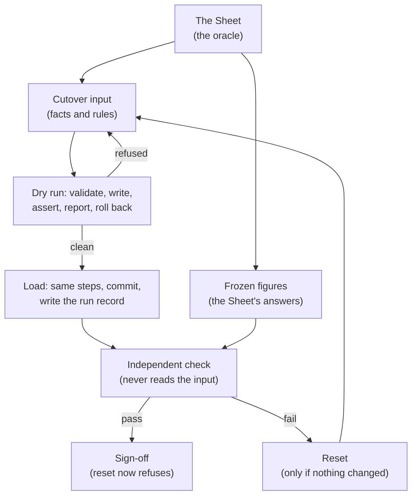

# The Sheet Is the Oracle: Cutting Tally & Trace Over From the Spreadsheet

[Tally & Trace](/work/tallyandtrace) has always had one job: retire the Google Sheet that runs
our household budget. This post is about the day that actually happened, and about the rule we
used to decide when it was done.

The rule was short. **The cutover is done when the balances match reality and the app's
projections match the Sheet, month by month.** Not "the rows are in." Not "the totals look
about right." Every account balance at the cutover date, to the centavo, and every month-end the
Sheet forecasts, either equal or explained in writing.

That rule changes what a migration is. You don't import the spreadsheet. You treat the spreadsheet
as the **oracle**, the answer key, and you make the model able to produce the same answers. Where
it can't, the bug is in the model, and fixing it is part of the migration.

_All figures, account names and examples below are illustrative. None of them are our real
numbers._

## Why "import the data" is the wrong goal

A spreadsheet is not a database with a different file extension. Ours mixes three kinds of thing
in one grid:

- **Facts**: what is in each account today, what is on each card statement.
- **Rules**: rent is due on a given day, a card is paid from one account and topped up from
  another when it runs short, an instalment plan has some number of payments left.
- **Conclusions**: the month-end balance the Sheet arrives at by applying the rules to the facts.

Copy the facts across and the app will happily show them back to you. That proves nothing. The
interesting question is whether the app, given the same facts, reaches the same **conclusions**.
If it does, the rules are encoded correctly. If it doesn't, copying more cells won't help.

So the migration became a correctness proof, and the Sheet's conclusions became the test.

## Part 1: Make the model able to answer

The first half of the epic was not migration code at all. It was every projection fix the app
needed before it could reproduce the Sheet. Most of those pieces (the single per-account event
engine, card statements that net payments, spending wallets, loans as liabilities) are covered in
[From Entities to Owners](/blog/tallyandtrace-rework), so I won't repeat them here. Two smaller
pieces only make sense in the light of the cutover.

### Instalments that started before the app did

The Sheet tracks a financed purchase as "payment 4 of 6". The app counts instalment progress from
linked transactions, the payments recorded through "Mark paid". That is a sound rule: better to
under-claim than invent a number. But the first four payments of that plan happened in the Sheet,
months before the app existed, and there is nothing to link.

The fix is an explicit **paid offset** on a fixed-term budget entry: the number of payments made
before import. Progress is linked payments plus the offset. A six-payment plan with four paid
before the cutover is stored with an offset of 4 and 2 payments remaining. Mark one paid and it
reads 5 of 6. The projection emits exactly the 2 remaining charges and nothing for the 4 already
made, because the imported history isn't linked to the entry and must not be re-emitted.

It is a small column, but without it the app would either claim a plan had barely started or
project payments that were already made. Both would put the forecast off the Sheet's.

### One projection, not two

Until the cutover, the dashboard did its own projection in the browser: it fetched accounts,
transactions and budget entries and added up the month itself. The backend had a better engine
by then, so the app had two answers to "what does this month look like," and only one of them was
being checked.

The dashboard now reads the backend's projection directly. The point was not speed; it was having
**one** projection to compare against the Sheet. If the dashboard and the forecast disagree, a
match against the Sheet only tells you that one of them is right.

## Part 2: A load that refuses to guess

With the model able to answer, the data could go in. The load is a script with a dry run, a
manifest of what it did, and a rollback. Its design comes down to one idea: **the input states
conclusions too, and the load checks them before committing.**

The input is not a dump of the Sheet. It is a structured file: accounts with their balance at the
cutover date, cards with the statements open at that date, loans with their terms, recurring
entries, and the transactions around the cutover. The load then works backwards and forwards from
those figures.

**Cash accounts.** The load doesn't trust a typed-in opening. It computes one: the balance at the
cutover, less the effect of every row loaded from before it. If Bank A held 10,000 on the cutover
date and a pre-cutover payment of 2,000 to Card B is part of the input, Bank A opens at 12,000, so
that after the history replays it lands exactly on 10,000.

**Cards.** A card always opens at zero, and its balance must be fully explained by its line items.
If Card B owes 3,000 at the cutover and the loaded lines add up to 2,800, the load refuses with a
`card_opening` problem: import the missing lines. On top of that, the load walks the card's
billing cycles from those lines, using the same statement code the app uses, and compares the
result with the statements listed in the input. A card isn't loaded until the app can produce the
same statements from the same lines.

**Loans.** A loan opens at its balance at the cutover, which must be below zero, since a loan is a
liability. The load also requires each loan to confirm that no due date is partly paid at the
cutover, because a half-paid instalment is exactly the case where the app's schedule and the
Sheet's could quietly disagree.

**Recurring entries.** A monthly entry can carry a day rule, such as the last weekday of the
month, or an anchor day. The load checks each entry's next occurrence against that rule using the
API's own day logic, so an entry is never stored on a day its own rule would not produce.

Mechanically, it is strict in the ways a one-off script usually isn't:

- **Every write goes through the app's own write paths**, in one database transaction. There is no
  side door that inserts rows the app itself would have rejected.
- **The load asserts its result before committing**: each account's ledger balance at the cutover
  equals the input's figure, and each card's statements equal the input's. A failure rolls the
  whole thing back.
- **The dry run does everything, then rolls back.** It validates, writes every row, runs the
  assertions and writes a review report: per-account openings and balances, card statements, each
  loan's schedule, each instalment's n of m, and the row counts.
- **The real run writes a run record**, the manifest, with row counts and a fingerprint of the
  owner's loaded state taken inside the load.
- **The reset refuses if anything changed.** It removes the load only if the counts and fingerprint
  still match the run record, so it can never delete edits made after the load. Once the result is
  signed off, the reset refuses outright.
- **The terminal never shows figures.** Check names, keys, counts and pass or fail go to the screen;
  amounts go only to private report files outside the repository.

It also refuses an account that isn't empty, refuses a second run while one is active, and refuses
to connect to any database other than the one named on the command line. A cutover script runs
once, against real money, with no second chance to notice it hit the wrong place.

## Part 3: A check that never trusts the load

The load proves it wrote what the input said. That is not the same as proving the input matches
the Sheet. If the input has a typo, the load will faithfully load the typo and pass its own
assertions.

So the oracle got its own file: **frozen expected figures**, taken from the Sheet and written down
before the check ran. The check compares the database with that file and reports every difference.
Three properties make it independent:

- **It never reads the cutover input.** The frozen file refers to accounts by name, type and
  currency, never by the input's keys.
- **It shares no code with the load.** It imports nothing from the load package, and a test fails
  if it ever does.
- **It never writes.** It runs read-only, in one snapshot.

Its report has eight blocks, and each one is a different way the app could disagree with the
Sheet:

| Block                | Question it answers                                                                                      |
| -------------------- | -------------------------------------------------------------------------------------------------------- |
| `checkpoints`        | Is each account's balance right at each listed date, to the centavo?                                     |
| `card_statements`    | Does each card produce the statements the Sheet shows as still owing?                                    |
| `card_routing`       | Is each card paid from the right account, with the right overflow account?                               |
| `loans`              | Do owed, payments made and left, and the next due dates match?                                           |
| `recurring`          | Does every recurring entry match field by field, including instalment n of m?                            |
| `occurrences`        | For each entry and month, are the paid and projected occurrences the right count?                        |
| `foreign_invariants` | Is every posted row in its account's currency, and each cross-currency transfer has its received amount? |
| `sheet`              | Does the projection close each month where the Sheet does?                                               |

The `sheet` block is the definition of done made executable. It takes the account the Sheet tracks and
compares each month's closing balance and each month's net. Months already past close at the
ledger balance on the 1st of the next month. The current month and later ones close at the
**projection's** per-account closing, the same number the dashboard now shows. A month-by-month
comparison looks like this:

| Month    | Sheet month-end | App closing | Difference                   |
| -------- | --------------: | ----------: | ---------------------------- |
| October  |          45,000 |      45,000 | none                         |
| November |          47,500 |      47,500 | none                         |
| December |          41,000 |      41,500 | 500, approved: reason stated |
| January  |          44,000 |      44,500 | 500, carried from December   |

Nothing is absorbed. A difference is either a failure or an **approved difference**, which names
its month, its amount and its reason, and applies cumulatively to the months after it. An honest,
written reason is fine. A silent fudge factor isn't possible.

The test I trust most is the dullest one. It loads a fixture with **one** deposit changed and runs
the check against unchanged frozen figures. The check must fail, fail in `checkpoints` only, and
name the account, the date, the expected and actual balance, and the difference. For example, if a
deposit of 1,000 were changed to 1,050, the check would report the 50 difference on that account
and nothing else. A check that can't find one wrong row isn't proving anything.

### The shape of it

The runbook makes the whole sequence pass against a local copy of the database first: dry run,
load, check, reset, load again, check again. Production is touched only after that.

## The edges that only real data finds

Building against an oracle surfaced cases that no amount of reasoning about the code would have:

- **Time zones.** The date columns store a timestamp, so "the balance on the 1st" depends on which
  day midnight falls in. Every load and check session is pinned to UTC, and sign-off refuses a
  check that read its dates in any other zone than the load wrote them in.
- **A cutover that isn't on the 1st.** If the load lands mid-month, the Sheet's first comparable
  month is the next one, and the `sheet` block has no ledger opening to read yet. Rather than
  quietly skipping it, the check refuses that block, and sign-off accepts only that one refusal,
  only with a written reason, and only if every other block passes.
- **Ambiguous matches.** Counting occurrences means matching unlinked transactions to entries. A
  row that matches two entries is a failure, not a coin toss; the frozen file gets a description
  fragment to tell them apart.

And one honest footnote: the check is now historical. After the cutover, statement due dates
started rolling to the next banking day when they fall on a weekend or holiday, and a card can
carry the due date printed on the statement itself. The check walks cycles with both today, so a
due date frozen before those changes can differ from what it computes now. That's the oracle doing
its job: it pins the answer at a point in time, and the code moved on afterwards.

## Why this matters

The epic closed when the definition of done held: balances matched reality, and the projection
matched the Sheet month by month, with every difference written down. Most of the work wasn't
migration code. It was making the app able to reproduce what the Sheet already knew, and building
a load and a check strict enough that "it matches" means something.

The test of a migration like this isn't that the rows were copied. It's that the app reaches the
Sheet's answers on its own.
