# When Can I Buy It? Funding the Wishlist from Free Flow

[Tally & Trace](/work/tallyandtrace) has a wishlist. You add something you want, and the app tells you
roughly when you could afford it. The date came from a shortcut: take your monthly leftover money
and assume **half** of it is free to spend on the wishlist. That shortcut was wrong, and this
post is about replacing it.

The work is merged and live. Every figure below is made up for the example.

## Why "half of disposable" was wrong

The old figure started from "monthly disposable": income minus your recurring bills. Then it took a
fixed 50% of that and called it the wishlist budget.

Say your recurring entries show ₱50,000 of income and ₱24,000 of bills. Disposable is ₱26,000, so the
app assumed ₱13,000 a month was free. Four things were wrong with that:

- **It only read recurring entries.** Spending that has no recurring entry, such as groceries,
  fuel or a one-off repair, was ignored.
- **Loan payments cost nothing.** A monthly loan payment did not reduce the figure.
- **Saving counted as available.** Money you already commit to savings still looked free.
- **Goals were never consulted.** A savings goal could be falling behind and the wishlist would not
  notice.

The fixed 50% was a guess standing in for all of that. It was the same for everyone, whatever
their goals or their habits.

## Free flow, built from what happened

The replacement is a figure called **free flow**: the money left each month once your real spending and
your savings plans are paid for. It has three parts. Net flow and saving are monthly averages over your
last full months (up to 12, and never the current month, which is not finished). A goal's pace is
different: it comes from the goal's current target, its deadline and what it already holds.

1. **Net flow** is what actually came in, minus what actually went out, minus loan payments. It is
   read from posted transactions on your own accounts, not from what was scheduled. Moving money
   between your own accounts is not income and is not spending, though some fees on those moves count
   as spending. On a loan payment, the amount repaid is the loan payment and its fee is spending.
   Money borrowed is not income.
2. **Saving** is what you actually put into savings accounts, net of anything taken back out. Money that
   comes back out of savings never counts as new income.
3. **Goals, in rank order.** Each savings goal has a monthly pace it needs to hit its target. If you
   are already saving that much toward it, nothing more is set aside. If you are not, the gap is
   called a **top-up**, and it is set aside too.

Free flow is net flow, minus saving, minus the top-ups, and never below zero.

A worked example, all invented. Over the last 12 months you averaged ₱50,000 in, ₱31,000 of spending
and ₱4,000 in loan repayments. Net flow is ₱15,000. You put ₱6,000 a month into a savings account that
a goal tracks. That goal needs ₱9,000 a month to reach its target on time, so its top-up is ₱3,000.
Free flow is ₱15,000 minus ₱6,000 minus ₱3,000, which is **₱6,000**. The old method said ₱13,000.

```mermaid
flowchart TD
    A["Posted transactions<br/>on your own accounts"] --> B["Net flow<br/>in - out - loan payments"]
    A --> C["Saving<br/>actually put away"]
    D["Savings goals<br/>in rank order"] --> E["Top-ups<br/>what goals still need"]
    B --> F["Free flow<br/>net flow - saving - top-ups"]
    C --> F
    E --> F
```

When money is short, the goals are not treated equally. You rank them by dragging them into order.
The lowest-ranked goal gives way first, and the app flags it as underfunded by the amount it is missing.

## Why critical items come before saving

A wishlist item has a priority. The top level is **critical**, meaning an urgent need such as a broken
laptop you work on. The rest are **wants**.

The rule is that a critical item is funded from net flow, which is the money before saving. A want is funded
from free flow, which is the money after saving. An urgent need should not wait behind your savings
plan. A want should not jump ahead of it.

Take two full-payment items in the same currency, a ₱18,000 repair and a ₱60,000 want, using the
numbers above:

- The repair is critical, so it uses net flow of ₱15,000. It takes 2 months.
- For the repair, the app also shows what the month would look like if you bought it now: net flow
  of minus ₱3,000. It also shows about how much would come out of saving: ₱6,000.
- The want queues behind the repair, which is counted once. It uses free flow of ₱6,000, so it needs
  10 more months. The date is 12 months out.

An item is only given a date when the figures behind it are sound. Otherwise it gets a plain label
instead of a made-up date, such as "nothing is left after your savings goals" or "more than 5 years away".
An item you plan to pay from a savings account of your own gets no date, because the wishlist never reaches
into savings.

## Why the first slice covers one currency

Tally & Trace is multi-currency. Each free flow estimate uses one currency, and if your currencies
never mix, you can get an estimate in each.

If you move money between your own accounts in different currencies, the app has to pick an exchange rate
for that move. Whatever it picks, converting money can look like earning or spending it. Several
versions of the plan tried to handle this and kept getting it wrong, so I made a ruling: **single
currency first**.

What switches the estimate off is money or goals that cross currencies: a transfer between your own
accounts in different currencies, or certain goals that span currencies. Then you get no estimate.
The app says "Money
in more than one currency is involved, so this cannot be estimated yet" and shows no date. The free
flow figure and its dates never convert money. This is the cautious choice, and it is the main limit of the first slice. One
cross-currency transfer inside the 12-month window is enough to switch the estimate off in every
currency until it ages out.

## How the plan was shaped

This was planned before any code was written, and the plan did not survive its first reviews.

It went through **seven audit passes**: five full rounds and two follow-up rechecks. Each pass was an
independent review by three reviewers who had not seen each other's answers (the
[triple audit](/blog/triple-audit)). The early revisions measured free flow from recurring
entries, and kept missing how wallets, cards, loans and currencies interact. Each pass found more.

Three owner rulings cut the scope:

1. **Own accounts only.** Accounts shared with you are outside the figure, and money arriving from
   accounts you do not own is not income.
2. **Actual transactions, not scheduled entries.** The figure is what happened, not what was planned.
3. **Single currency first.** The cross-currency cases wait for their own plan.

Two smaller decisions came with them: an item paid from savings gets no date, and mobile shows dates
without the "based on your last N months" note for now.

Everything cut was written down as later work:

- **Estimates across currencies**, for people whose money or goals span more than one.
- **A month-by-month simulation**, which would show which goal a critical purchase delays, and by how
  long. Slice 1 has no simulation.
- **Counting scheduled but unposted money**, such as a new bill that has not hit yet.
- **ADB mode**, a separate way of looking at the same question that was split out of this plan.
- **Mobile screens.** The mobile app is unchanged.

The final audit pass still said no-go. I approved the plan anyway, with the open findings written into the
tickets as acceptance criteria, so each one had a test attached.

## How it was built

The build was six code tickets, each written by a separate writer on stacked branches: goal ranking
in the API and the web app, the free flow service, the wishlist rules, the wishlist screen, and the
goal pace and underfunded flag.

Each pull request got an independent audit pass and one round of fixes. One rule mattered more than any other:
**a finding had to be reproduced by running it before any code changed.** An audit finding is a claim, and
some claims are wrong.

Several were real bugs. A reorder of your goals could be overwritten by an older response arriving
after a tab switch. Money withdrawn from a savings account was still counting toward a goal. A few
findings were declined, and a few were kept as stated limits instead of fixed.

## The limits, stated plainly

These are the limits of the calculation. In short:

- **It is what happened.** A new bill, a raise or a lost income only shows once it has posted, and
  takes up to 12 months to count fully.
- **It is a plain average.** A one-off windfall raises it and a one-off large purchase lowers it for
  up to a year.
- **A new user has no estimate** until one full calendar month of history exists.
- **Accounts shared with you do not count**, including a partner's account.
- **Existing balances are not money the wishlist can spend.** Only monthly flow is. A goal's own
  savings do reduce what it still needs.
- **A goal that tracks a checking account or wallet** is treated as holding nothing there, so it
  reserves its whole pace.

I would rather show a date with its caveats than a precise-looking number that quietly rests on a guess.
