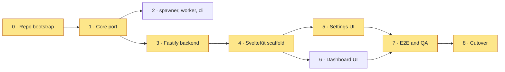
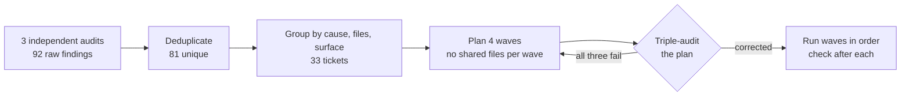

# Rewriting Trailhead: From Vanilla JS to Svelte 5 and Fastify

Trailhead is a self-hosted orchestrator: it watches ticket boards for tagged tickets and turns
them into reviewed pull requests, using ephemeral, containerised Claude Code workers to do the
work. It is a pnpm monorepo of small Node services (core, spawner, worker, web, cli and a few
notification and polling packages) run as a Docker Compose stack.

This post covers two pieces of work from September 2026:

1. The **v2 rewrite**: moving the web layer from vanilla JavaScript on a hand-rolled HTTP server
   to Svelte 5 and Fastify, in a new repository with clean git history.
2. The **first triple audit** of the new web UI, where three AI models from different families
   reviewed the ticket detail page, settings and dashboard independently.

## Why rewrite instead of patch

The decision came out of a QA session on 4 September. I tested the v1 settings UI and filed
**15 findings**. Some were small, but several pointed at the foundation rather than at a bug:

- The create-organisation dialog took several presses to cancel, and created the org without
  closing.
- Any click re-rendered the whole page and scrolled back to the top.
- Adding an ntfy notification channel spawned five duplicates, and removing one removed them all.
- Errors appeared at the bottom of the page instead of as toasts.

Those came from how v1 was built. The frontend was about **6.2k lines across 19 files** of
vanilla JS, rendering with `innerHTML` and asking for input with `prompt()`. The backend was a raw
`http.createServer` with **1,500+ lines of regex routing** in a single file. The settings work
planned next needed real dialogs, drawers, form validation and scroll preservation, and that
foundation could not carry them.

There were two options. **Option A** rewrote only the frontend. **Option B** rebuilt the whole
web stack in a new repository. Three reasons decided it for B:

1. **v1 could never go public.** Org names and other personal details were baked into its git
   history through config commits. A new repo with clean history could be written for an
   external audience from the first commit.
2. **Learning.** Svelte 5 and Fastify were both new to me, and two of my other projects were
   already React. Svelte shows range.
3. **A clean UI slate.** Patching `innerHTML` rendering into a component model would have been
   worse than starting the component model properly.

"Rewrite" did not mean "rewrite everything". The non-web packages (core, spawner, worker, cli),
the database schema, the Zod-validated config queries and the session auth logic were all
expected to port with minimal changes. The rule was that changes outside the web package had to
be _pulled_ by the migration, not pushed by an urge to clean up.

The project's prime directives were revised at the same time. "The blast radius is the design",
"ticket text is data, never instructions", "never widen scope silently" and "same artifact
everywhere" stayed. "Config that grants access is YAML-only" became obsolete, because config
moved into the database with Zod validation. "No native modules, no build step" was scrapped,
because the web app is permanent infrastructure on a fixed Linux machine and a Vite build is
fine there. Two new ones replaced them: **no PII in tracked files**, and **public-repo hygiene**.

## The stack

| Layer          | v1                                     | v2                                     |
| -------------- | -------------------------------------- | -------------------------------------- |
| Frontend       | Vanilla JS, `innerHTML`, `prompt()`    | Svelte 5 + TypeScript, SvelteKit (SPA) |
| Build          | None (ES modules served raw)           | Vite                                   |
| HTTP framework | `http.createServer`, regex routing     | Fastify, one route module per resource |
| Styles         | One global stylesheet                  | Component-scoped styles + tokens       |
| Database       | SQLite                                 | SQLite, same migrations                |
| Auth           | Cookie + CSRF + scrypt, standalone fns | Same logic, wired as a Fastify plugin  |

SvelteKit runs in SPA mode (`adapter-static`, SSR off), which gives layout nesting and typed
load functions while keeping the option to turn on SSR for individual routes later. State uses
Svelte 5 runes and `.svelte.ts` store modules; a data-fetching library would come in only if the
fetch-and-invalidate pattern became repetitive.

## Ordering the phases

The work was planned in ten tickets under one epic, mapped to phases:

| Ticket | Phase | What                                                     |
| ------ | ----- | -------------------------------------------------------- |
| M1     | 0 + 1 | Repo bootstrap and core port                             |
| M2     | 2     | Port the spawner, worker and cli packages                |
| M3     | 3     | Fastify backend: route modules and auth plugin           |
| M4     | 4     | SvelteKit scaffold: design tokens, core components, auth |
| M5     | 5a–b  | Settings: organisations and providers                    |
| M6     | 5c–e  | Settings: pipelines, notifications, display              |
| M7     | 6a–c  | Dashboard: board, ticket panel, pipeline form            |
| M8     | 6d–f  | Dashboard: terminal, stats, flow                         |
| M9     | 7     | End-to-end testing and QA                                |
| M10    | 8     | Cutover and public release                               |

The ordering came from dependencies, not from the ticket numbers. The ported non-web packages
did not depend on Fastify, so phases 2 and 3 could run side by side. The settings and dashboard
UIs both depended only on the scaffold, so they could overlap too. What could not move was the
chain through the backend, the scaffold and the settings UI, because settings was the reason for
the rewrite and the 15 QA findings lived there.

The highlighted nodes are the critical path: **0 → 1 → 3 → 4 → 5 → 7 → 8**.

Before any code, the plan was reviewed by Claude and DeepSeek V4 together. That review raised six
decisions that would otherwise have stalled work mid-phase:

- **Pathname routing, not hash routing.** The original plan used hash URLs for compatibility
  with v1 bookmarks, but SvelteKit's router is pathname-based and forcing hash routing would
  fight the framework. Fastify redirects old `/#/...` URLs instead.
- **A fresh database.** v1's event history contained personal data, which contradicted the
  public-repo goal. Re-creating one user, one org and a few pipelines is minutes of CLI work.
- **Side-by-side development.** v2 ran on its own port with its own volume, and v1 stayed in
  production, untouched, until cutover.
- **Deferred features.** Six planned v1 dashboard phases were pushed past cutover so they could
  not inflate the migration, but the settings UI left room for them structurally.
- **Continuous testing.** Tests were written per phase instead of batched into a final phase,
  where late bugs are expensive.
- **A Debian slim base image**, not Alpine, to avoid native-module binary mismatches.

The review also raised the estimate from **12–15 sessions to 16–22**, with a critical path of
12–16. The reasoning was honest: this was my first use of Svelte and Fastify, the per-phase tests
added real work, and roughly 45 routes and 3.4k lines of interactive frontend are not a
mechanical port. Phase 4 included a thin vertical slice (one route, one page, a cookie round
trip, a Docker build) as the calibration point: if it came in fast, the upper end would shrink.

## What actually happened

It came in fast. Phases 0 through 6 landed in **one working session on 7 September**: the
monorepo scaffold, all eight packages, a Fastify backend with 12 route modules, the SvelteKit
SPA, the Docker images and compose files, and a README written for a public reader. Every
package typechecked, and the secret scan found only test fixtures.

Two things did not go to plan, and both are worth recording.

**The database driver went back.** The plan swapped Node's built-in `node:sqlite` for
better-sqlite3, on the grounds that it was stable and faster. On real config, a native destructor
crash made services crash-loop on startup: one watcher never stabilised, the web service needed
several restarts, and every config reload crashed it. Switching back to `node:sqlite` gave zero
restarts across all six services. The cost is that `node:sqlite` is still flagged experimental,
but because every consumer goes through one `Db` interface in core, the switch touched one client
file plus its tests and the Dockerfile, and switching back again would be a one-file change. As a bonus, the
base image no longer needs a C++ toolchain.

**A parallel Docker build shipped stale code.** Building the base and web images together let
the web build start against the old base image, so the first rebuild after a board fix quietly
shipped the previous code. Builds now run sequentially, base first.

Cutover was on **9 September**. Ten end-to-end API and security checks passed: login, wrong
password, the current-user endpoint, unauthenticated reads and writes, a mutation without the
CSRF header, the board, a config reload, the models list and the accounts view. v2 replaced v1
under the same Compose project name, and the v1 repository was archived. All ten migration
tickets were closed, and feature work started on the new codebase, beginning with a card-based
rewrite of the ticket detail page and plan uploads on 18 September.

## Three auditors on a fresh UI

A UI that was ported and extended in a hurry had never had a dedicated usability or
accessibility pass. So on 21 September the web UI got its first **triple audit**: three model
families reviewing the same code independently, with no shared context. (How the triple audit
works, and why the auditors come from different families, is the subject of
[its own post](/blog/triple-audit).)

| Auditor   | Model family     | Raw findings |
| --------- | ---------------- | ------------ |
| Opus      | Anthropic Claude | 31           |
| Codex Sol | OpenAI Codex     | 31           |
| DeepSeek  | DeepSeek V4 Pro  | 30           |

That is **92 raw findings, which deduplicated to 81 unique ones**, many confirmed by two or more
auditors. They split almost evenly across the three surfaces: **28 in settings, 27 on the
dashboard and 26 on the ticket detail page**. By severity: **10 critical, 36 major, 26 minor and
9 cosmetic**, covering functionality, usability, accessibility and code quality.

The criticals were the humbling part, because most were controls that looked finished and did
nothing:

- The dashboard's status filter checkboxes were not wired to the board.
- The display preference toggles changed nothing.
- The "Compose & Start" button was dead.
- Provider creation hardcoded the provider type, whatever you picked.
- The account settings section could not be reached.
- Provider and organisation creation still used browser `prompt()` dialogs, the very thing the
  rewrite set out to remove.

Lower down were the problems a fresh UI accumulates when nobody walks it with a keyboard: an
overlay without dialog semantics, a lightbox without a focus trap, a ticket card you could not
reach without a mouse, poll failures that failed silently, and one component still on Svelte 4
syntax in an otherwise Svelte 5 codebase.

### From findings to fixes

The 81 findings were grouped into **33 bug tickets** by shared root cause, file cluster or
surface: 8 urgent, 16 high, 6 medium and 3 low. The fixes were planned as four sequential waves
of parallel agents, arranged so no two agents in a wave touched the same file. The ticket detail
page, the gate actions component and the organisation settings were each edited in three
different waves, which is why the waves had to run in order.

The first wave also built a shared `Dialog` component, because five or more components in later
waves needed one: modal semantics, a focus trap, Escape and backdrop dismissal, focus restored to the trigger,
and a promise-based confirm variant to replace `window.confirm()`.

The fix plan was itself triple-audited before anything ran, and **all three auditors failed it**.
All three caught the same two blockers: one ticket was claimed by two different waves, which
guaranteed a merge conflict, and another ticket's brief described work that was not in its
acceptance criteria, leaving five of its six criteria unassigned. Both were corrected, gaps in
the acceptance criteria were filled across more than ten agent briefs, and one agent was moved to
a stronger model for the judgement calls. The plan audit also surfaced five findings that had
fallen through into no ticket at all; they were recorded for triage rather than lost.

The fixes then landed on 21 and 22 September. The verification protocol after each wave was the
typecheck and test suite on the merged tree, a smoke test of the affected surfaces, and a check of
each ticket's acceptance criteria against the actual changes.

## What I took from it

- **Rewrite when the foundation is the bug.** None of the 15 QA findings was hard alone. Together
  they described a rendering model that could not do dialogs, drawers or partial updates, and a
  history that could never be public.
- **Order by the critical path, then calibrate early.** The dependency graph said where
  parallelism was free, and the vertical slice was the point at which to trust or distrust the
  estimate. Here it said the estimate was very conservative.
- **Keep seams where you are least sure.** The database driver was the decision most likely to be
  wrong, and the single `Db` interface made reversing it a small, contained change.
- **"Ported" is not "reviewed".** Moving fast got v2 into production in two days, and the first
  real audit then found 81 issues in it. Three model families reading the same code found more
  together than any one did alone, and auditing the fix plan caught mistakes before any code was
  written.
