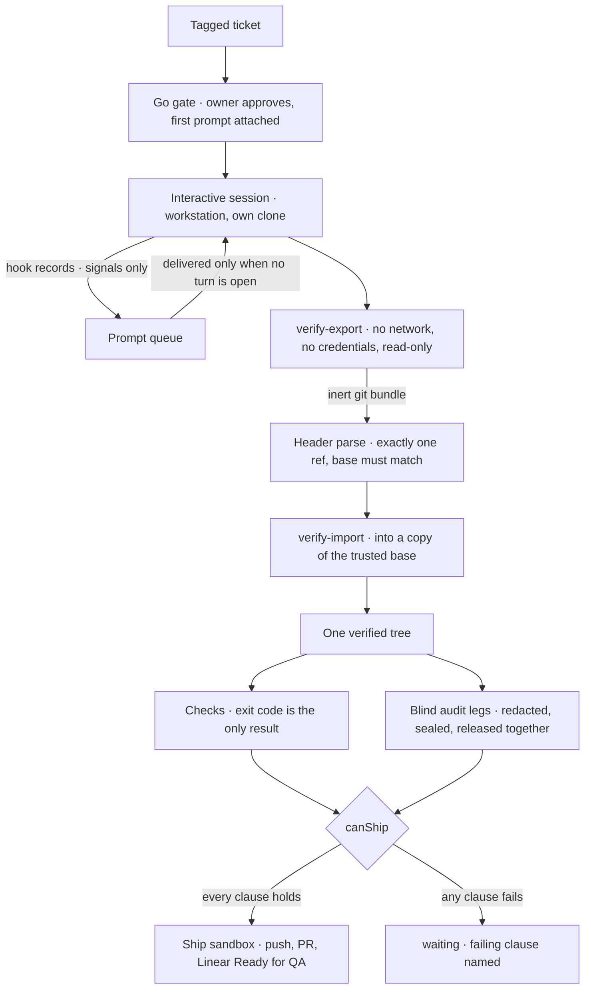

# The Session's Word Never Counts: Trailhead's Workstation Dispatcher

Trailhead is my self-hosted dispatcher: tag a ticket, walk away, and come back to a pull request
that passed its checks and an independent audit. The [v2 rewrite](/blog/trailhead-v2-rewrite)
built it around a **phase engine**: short-lived worker containers that took a ticket through fixed
phases, with gates in between.

It worked, but I couldn't watch or steer the work. Once a phase started, it ran headless until it
stopped. I wanted to work _through_ Trailhead the way I work in Claude Code: see the session, nudge
it, interrupt it, paste a screenshot. I didn't want to give up the part that made Trailhead worth
having, which is that nothing ships on an agent's say-so.

This post covers the epic that squared those two: the **workstation dispatcher**. It ran from an
approved plan on 7 October to the final cleanup deploy on 2 November.

## The shape in one paragraph

The design doc opens with this paragraph, and everything else follows from it:

> Trailhead becomes a deterministic dispatcher around one long-lived workstation container. That
> container holds credentials the ephemeral workers never see and runs one interactive
> `claude --remote-control` session per ticket under tmux, each in its own clone. Trailhead owns
> the go gate, the prompt queue, checks, audits, push or PR, and Linear state changes. The
> session's word never counts.

The session is the non-deterministic part. It's a real, interactive Claude Code session that I can
open from the dashboard or from the Claude app on a tablet. Everything around it is code that
behaves the same way every time.

## Spike first: can Remote Control carry this?

The whole idea rested on one capability: Claude Code's Remote Control, started headless inside a
container, holding up for long-lived sessions. So before any plan, a go/no-go spike ran in a
throwaway compose project that touched no production code. Its question was whether one container
with one login could run several per-ticket interactive sessions, each in its own worktree,
reachable remotely, even after sitting idle.

In my runs, most checks passed:

- Two sessions launched headless with no keystrokes, and both showed up in the Claude app.
- An image pasted from a tablet was read accurately. Subagents were visible from the app, and
  stopping one froze it while its sibling carried on.
- Each session committed only to its own branch and worktree.
- Injected prompts were processed once, by the right session. A forged approval planted in ticket
  text did not count.
- Sessions resumed after a container restart with their history intact.
- After about four hours truly idle, with a proxy restart in the middle, remote prompts still landed
  in the right transcripts.

One check was inconclusive: reading a PDF sent from the app. The spike's constraints list mattered
as much as the passes, and one line in it became the design rule for the whole epic: **sessions
misreport their own work; the dispatcher must verify independently.** The spike also made clear
that a long-lived workstation would hold credentials the ephemeral workers never see, so its
boundary had to be the tightest.

## A plan that took four audit rounds

The implementation plan went through my [triple audit](/blog/triple-audit) before any code.
DeepSeek was paused at the time, so the Opus and Sol legs ran it. By my account, it took four rounds on 7 October:

- **Round 1: NO-GO from both.** The critical finding was real and already live. A helper the plan
  meant to reuse was handling a credential in a way that could persist it somewhere it shouldn't.
  It was fixed in its own change, shipped ahead of the epic.
- **Round 2: NO-GO again.** The snapshot pipeline couldn't open its own bundle. `git archive` also
  honours repo-controlled attributes, so the checked snapshot could differ from the shipped tree.
  Two rounds without convergence meant the call went to me. I chose to **simplify the snapshot
  pipeline**, which is the design described below.
- **Round 3:** Opus GO-WITH-FIXES, Sol NO-GO. Sol reproduced a hardened git setting that blocked the
  HTTPS push at ship time. The fixes were narrow and mechanical, and nothing reopened the
  architecture.
- **Round 4**, scoped to the changes: GO-WITH-FIXES from both, no criticals. I approved
  **revision 4.1** with those fixes folded in.

## Determinism around a non-deterministic worker

Here is the path a ticket takes. Only one box is the model.

### The go gate and the prompt queue

Nothing starts without the owner's go, and the first prompt is attached at that point. From then on,
Trailhead decides what reaches the session. Claude Code hooks append records to a spool file, and
the spawner drains it every two seconds. It pairs each prompt with the Stop that ends its turn and
releases the next queued prompt only when no turn is open.

Those hook records are **signals, never authority**. The workstation has no network route back to
Trailhead. If the session forged or deleted its spool, the worst outcome would be a spurious check
run or a stalled queue. Both are visible, and the owner can recover from either. Missing hooks cost
liveness, never safety. Ticket text is treated as data. It is fenced and stripped of control bytes,
because an auditor found that a stray escape byte could break bracketed paste and turn ticket text
into keystrokes.

### One verified tree

This is the core of the design: _one trusted base, one inert bundle, one verified tree_.

1. A credentialled fetch makes a bare clone of the repo and records the base commit. That clone is
   private, read-only from then on, and never mounted into the workstation. The credential never
   enters the workstation or any volume it can see, so sessions cannot push.
2. When there's work to check, **verify-export** is the only sandbox that ever touches the session's
   repo. It has no network, no credentials and no writable mount. It does exactly one thing:
   `git bundle create` from the base to the branch. It doesn't even run `git status`, because that
   would run any clean filter the session planted in its git config.
3. The spawner parses the bundle header in plain TypeScript, without git. It requires exactly one ref
   and exactly one prerequisite, and that prerequisite must equal the recorded base. The ref's commit
   becomes the frozen head.
4. **verify-import** never sees the session repo. It imports the bundle into a copy of the trusted
   base, with no network, and produces the tree.

Every git call runs under a hardened profile, set only through environment variables: no hooks, no
fsmonitor, no filter drivers. Offline steps cannot open a network transport, and the networked steps
cannot read a local path. The design doc states the result plainly:

> What is checked, audited and shipped is one tree, identified by the bundle hash and the tree id,
> and proven byte-identical to the frozen commit.

The worst a malicious session config can do is run code inside verify-export, which can only change
which bundle bytes come out. Those bytes are then validated against the trusted base.

### Checks and blind audits

Checks run in a throwaway container against a copy of the verified tree. The process's **exit code
is the only result**. The checker also prints a marker line, but repo code can print the same text,
so the spawner ignores it.

Audit legs are ephemeral containers, one per auditor. Each gets the brief, the diff and the tree,
all read-only, and can reach only its own model's API. Each leg's output is redacted for
credentials, then hashed and **sealed** before anything is stored. Legs are released only when every
leg has finished, and nothing returns leg output before release. The worst leg sets the verdict, and
a failed leg makes the whole audit INCOMPLETE. A leg with the wrong nonce, a missing verdict line or
a model mismatch fails. The audit is blind to the orchestrator and to the session.

### The ship predicate

Ship is a request, not a button that only works once everything is green. The request runs whatever
is missing for the current head: verify, then checks, then audit. Just before the push, the spawner
re-runs verify-export and the header parse to confirm the head hasn't moved. Then it evaluates
`canShip`, which is true only if every clause holds:

1. The current head equals the audited head.
2. The bundle hash and tree id are identical across verify, every check run and the audit.
3. The branch, trailer and command checks all passed for that bundle.
4. The audit is a ship audit, released with GO for that bundle. A plan audit never counts.
5. No other ship is running.

If any clause fails, the session goes to `waiting` with the failing clause named, such as "head
moved". If they all hold, a ship sandbox pushes, opens the PR and moves the ticket to Ready for QA.

## M1: one real ticket, end to end

Milestone 1 was a vertical slice: one real ticket from tag to PR on an isolated **smoke pipeline**.
That scratch pipeline ran on the new engine, fed by sandbox tickets and a real Linear client, with a
real PR at the end. The acceptance script restarts the spawner and the watcher partway through, to
prove the pipeline recovers.

It didn't pass on the first try, and in my runs the failures were the best evidence for the design:

- **Run 1:** the script's default prompt created one file while the ticket asked for a different
  one. Both audit legs returned NO-GO, so no PR was opened. The session had done _something_, but the
  gate held.
- **Run 2:** one audit leg returned a valid GO, but it failed a size check on its staging directory,
  so the audit was INCOMPLETE and nothing shipped. The cause was a newer Codex release keeping more
  state on disk. It was fixed in its own ticket.
- **Run 4:** every product step passed, but the script failed one assertion. Linear's issue history
  didn't show a state change. The most likely cause was Linear folding same-account edits made
  within seconds of an issue's creation into the creation entry.
- **Run 5**, on a ticket that had aged 20 minutes: **passed**, every step. The audit came back GO
  with two sealed legs, exactly one PR was created, and the ticket moved to Ready for QA. A token
  scan across the run's output found nothing.

The production pipeline was flipped to the workstation engine the same day, 12 October. The two
engines ran side by side behind a per-pipeline flag until the old one was removed.

## M2 to M4: making it usable

Each later milestone started with its own planning pass and plan audit, then waited for my approval
before any code was written.

**M2, interactive sessions.** When planning started, my top complaint was that I couldn't watch or
steer sessions from the web UI. M2 delivered:

- needs-you notifications (session waiting, interrupted or failed; ticket ready for QA) that deep-link
  to the ticket
- a terminal mirror, plus a separate read-only bash terminal with no network or credentials
- an interrupt lifecycle that treats an uncertain key delivery as uncertain, not as success
- park, resume and liveness, with a park-all used as the deploy path
- a session cap (three by default) that parking frees up
- retention, subagent list and stop, attachments, and plan audits

A separate spike checked interrupt, subagents, the remote link, watch data and resume against the
live workstation first. Every question passed. Both M2 live acceptance runs passed on 18 October.

**M3, settings.** M3 moved configuration into the dashboard: secrets (write-only from the browser),
intake, templates, auditors, workstation egress, users, gates, display, notifications and backups.
Its six-step live acceptance passed on its first run, on 20 October.

**M4, several tickets in one session.** A session can now carry a bundle of up to 20 tickets from
one pipeline and repository, with one branch and one PR. M4 added:

- a multi-ticket start, and a mini go gate for adding tickets later
- an optional combine turn, in which Claude may write only a single bundle file that I read and
  accept before work starts
- a finish rule: Ship is refused until every member is finished
- a membership lock once a ship is attempted
- QA send-back that reopens only the named tickets and reuses the PR
- recovery onto a fresh branch

This is where the rule shows most clearly. Claude can mark a ticket as **claimed** in a status file,
but only my Confirm makes it **finished**. The M4 acceptance script passed 8 of 8 steps on its third
run, on 23 October.

M5 brought Jev into the loop as a typed judge, and M6 added per-user QA workstations. Jev has
[its own post](/blog/jev-audit-autonomy).

## W, M, D: deleting the old engine

After M3 came a batch of UI workstreams. Then I set the order: finish every W workstream, then the
M milestones, then the D cleanup gates.

The deletion happened mostly inside the W batch. One release deleted the phase engine's code: the
phase actions, the spawn queue, the phase workers, their routes, the CLI verbs and the bot's slash
commands. The next release dropped its tables. By the time the D gates came up, a fresh planning
pass found D1 to D3 mostly superseded. The leftovers became three small tickets, and the other two
gates were cancelled as superseded.

The last leftover was a migration dropping the phase-era columns. It carries its own guard: if any
pipeline is not on the workstation engine, it aborts and leaves the database as it was. It was
rehearsed on a copy first and deployed on **2 November**, which closed out the epic.

## What I'd keep

- **Spike the risky dependency before planning around it.** The Remote Control spike's constraints
  list shaped the design more than its passes did.
- **Make the trusted thing small and the untrusted thing inert.** The session can do whatever it
  likes in its clone. What leaves is a bundle, validated against a base it never touched.
- **Let failing gates prove the design.** The best M1 evidence was the run where the work was wrong,
  both auditors said NO-GO, and no PR appeared.
- **Never take an agent's account of its own work.** Hooks are signals. Status marks are claims.
  Exit codes, hashes and sealed verdicts decide what ships.
