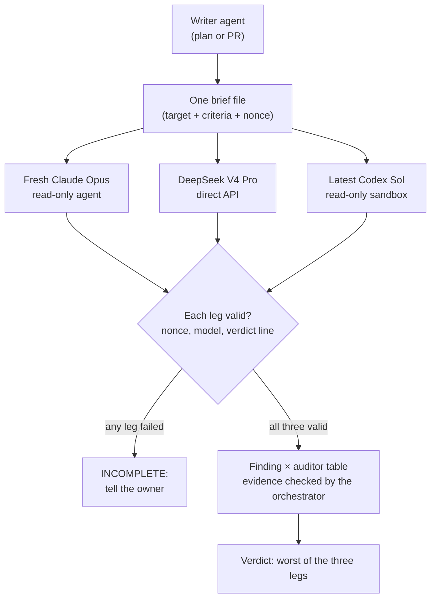

# Three Auditors, No Shortcuts: The Triple Audit

Most of the code in my projects is now written by AI agents. One main session plans the work and
hands it out, other agents write it, and I review what comes back. That raises an obvious question:
who checks the agents?

As of today the answer is fixed. **"Audit" always means a triple audit, on every plan and every pull
request.** Three independent reviewers from three different model families read the same brief. The
brief leaves out the writer's conversation and the other auditors' answers, every auditor is told not to
go looking for them, and the main session puts their findings side by side before anything moves
forward. This post covers why one reviewer isn't enough, how the reviewers are
kept blind, what it costs, and the rules that keep it from growing without limit.

## Where it started: the web UI sweep

The first real run was on 21 September, against the web UI of Trailhead, my self-hosted orchestrator
that turns tickets into reviewed pull requests. The UI had never had a dedicated usability and
accessibility pass, so three auditors were asked to read it independently and report every bug,
usability gap and accessibility problem they could find.

The three reports held 92 findings between them. After merging duplicates, **81 were unique**, and
many had been confirmed by two or more auditors. Each finding carried the auditor that raised it and a
file and line reference. Those 81 were grouped by root cause, file cluster or screen into **33 bug
tickets** under one epic, eight of them urgent: filter checkboxes that did nothing, a "Compose &
Start" button that was dead, a settings section that could not be reached.

That result was the argument. Each auditor raised about 30 findings on its own, and merging the
duplicates only took the total from 92 to 81. The overlap was small: most problems were seen by just
one of the three.

## Why one reviewer isn't enough

A single reviewer, especially one from the same model family as the writer, tends to inherit the
writer's assumptions. If the model that wrote the code thinks a pattern is fine, a fresh copy of the
same model is likely to think so too. Different families have different blind spots, so three of
them together cover more ground than any one, or than three copies of one.

The rule also had to become **universal** rather than optional. Before today the triple audit was
reserved for "mission-critical" work, and in practice that meant it kept getting skipped or
watered down. On 22 September a plan went ahead on a degraded audit: two legs instead of three, and
one of those returned an empty answer. I had to keep reminding the agent to run the audit at all.

So the rule was rewritten in my words: when I say audit, it means always triple audit. There is no
single-reviewer tier. A plan is audited before I am asked to approve it, and a pull request is audited
before it opens and again before it merges, without anyone needing to ask.

## The three auditors

As of today the default auditors are:

- **A fresh Claude Opus 5.5**, started as a read-only agent with no access to the writing session.
- **DeepSeek V4 Pro**, called directly through its API.
- **The latest Codex Sol model**, run through the Codex CLI in read-only mode. The CLI is updated as
  the first step of every audit, and the newest Sol model is picked at run time rather than pinned.

Codex has one job here: it audits. It never writes or changes code. The agents that do the
implementation are Claude models; the auditors are deliberately drawn from outside that family as
well.

## How blindness is kept

Independence only means something if it holds every time, so the audit is a fixed runbook rather
than a habit. Blindness comes from what the brief contains and what the auditors are told, not from a
hard wall: the Opus auditor can read files, so it is kept away from other answers and transcripts by
instruction.

**One brief, written once.** The main session writes a single brief file: the full target (the plan
text or the pull request diff), the criteria it is judged against, and a fixed preamble. All three
auditors get the same file. The writer's conversation is never included, and nor is any other
auditor's output.

**The preamble sets the rules.** Each auditor is told it is one of three independent auditors, that it
is read-only, and that it must not read other audit outputs or the writer's session transcripts.
Every finding is numbered, given a severity (critical, warning or note), and must **quote the exact
text or code it concerns**, with its reasoning and a suggested fix. A finding that cannot point at
something real in the target has nothing to stand on.

**Each answer has to prove where it came from.** The brief carries a random nonce, and a leg only
counts if its answer echoes that nonce exactly, ends with exactly one of three verdict lines, and
either lists numbered findings or says `No findings.` On top of that, each leg's model identity is
checked from its own run: the Codex CLI's printed model line, DeepSeek's HTTP status and finish
reason, and the Opus agent's transcript, which must show only Opus. A hollow `Verdict: GO` with
nothing behind it fails.

**Read-only is mechanical, not a request.** The Opus auditor is an agent whose only tools are read
and search; a check before launch fails the audit if that agent definition has gained any write tool.
Codex runs inside its read-only sandbox, so it can read files but not change them.

**A failed leg stops everything.** If any leg fails, the main session tells me straight away, with the
reason. It never swaps in another model, never drops a leg quietly, and never calls two legs a triple
audit. The one automatic retry is for DeepSeek when its reasoning uses up the token budget and leaves
an empty answer, and even that retry is reported.

## Synthesis: evidence, not majority

Once three valid answers are in, the main session builds one table: a row per finding, a column per
auditor, and each cell reading AGREE, DISAGREE (with the reason), `--` or FAILED. Findings that
describe the same problem are merged.

Disagreements are settled by evidence, not by a vote. The main session checks any claim about a file
itself before relying on it. It does **not** fix anything at this stage: its job is to verify and
report, and fixes go back to a writer.

That matters in both directions. Today's first plan audit had DeepSeek claiming the tool that starts
agents is called `Task`, not `Agent`. Two auditors to one would not have settled it; checking did. The
tool is `Agent` in this environment, and the finding was dismissed with that evidence. The same audit
had all three auditors independently agree that parts of the plan's gates could be bypassed, and those
findings stood.

The overall verdict is the worst of the three legs: **NO-GO** if any leg reports a critical finding,
**GO-WITH-FIXES** if there are warnings but no criticals, and **GO** only if all three say GO. If any
leg failed, the verdict is **INCOMPLETE**. A finding the main session refutes stays on the list, marked
refuted with its evidence, until I accept the refutation.

The gates follow from the verdict:

- A plan is implemented only after a GO or my explicit acceptance.
- A pull request with NO-GO or INCOMPLETE is not opened. With GO-WITH-FIXES it may open, but only if the
  commit being opened is still the one that was audited.
- A merge needs a GO on the current head, or my acceptance. If the code changed after the audit, it is
  audited again.

## What it costs

None of this is free, and it is worth being honest about where the cost goes.

- **Three model runs per review, and several reviews per change.** A plan is audited once; a pull
  request twice, before it opens and before it merges. Any commit after an audit means a fresh audit.
- **Wall-clock time.** The Codex and DeepSeek legs each get up to 30 minutes, and the main session
  waits for all three before it can say anything.
- **Concurrency.** I cap myself at three agents running at once, and the audit uses all three slots, so
  nothing else runs while an audit is in flight.
- **Rounds.** Audits do send work back. Today's first plan was NO-GO as written; its second version
  came back NO-GO again, with the auditors reporting 17, 15 and 12 findings in the first round. Each
  round is another full set of three.
- **Fragility.** Three external tools means three ways to fail. The empty answers on 22 September had
  plain causes: the Codex helper that was being used defaulted to write mode and could not fetch its
  own results, and DeepSeek's reasoning used up its token limit before it wrote an answer. The runbook
  now runs Codex directly in read-only mode and handles the DeepSeek case explicitly, but every new
  failure costs a stop and a conversation.

The trade I'm making is that this is cheaper than the alternative: merging something three reviewers
would have caught, and finding out later.

## Rules that keep it proportional

A review process with no limits can eat a project. Three rules stop that.

**Audit what was asked.** The target is the plan or the diff in front of the auditors. Findings are
answered within that scope, and the target is not allowed to grow to answer them. An auditor pointing
out a real problem elsewhere gets it mentioned, not folded into a bigger change.

**Two rounds, then ask.** If two rounds on the same target do not converge, the main session stops and
asks me. This happened today: a week plan went through two rounds and still came back NO-GO from two of
the three auditors. Rather than a third round, it came to me, and the two critical findings turned out
to be real bugs in Trailhead itself. Those got fixed first, as their own audited plan.

**The owner decides.** The audit never approves anything on its own. It produces a table and a
verdict; I make the call. When the auditors are split, or a finding is a judgement call rather than a
defect, the table puts it in front of me with the evidence instead of hiding it in a summary.

## Why this matters

The point of the triple audit isn't that any one model is a bad reviewer. It's that a single reviewer
shares too much with the writer, and that a review process only works if it runs every time, not when
someone remembers. Three families, one brief, no shared context, evidence over votes, and a hard stop
when a leg is missing: that's the whole rule, and from today it applies to every plan and every pull
request.

## Update (November 2026)

Running three full audits on every change turned out to be expensive, and not every change needs the
same scrutiny. Routing audits by risk is being trialled in shadow: the router records what it would
choose, while the triple audit stays the rule until that routing is admitted. Cost also led me to
approve a single auditor on some projects for now. That is its own story:
[letting an agent route the audits](/blog/jev-audit-autonomy).
