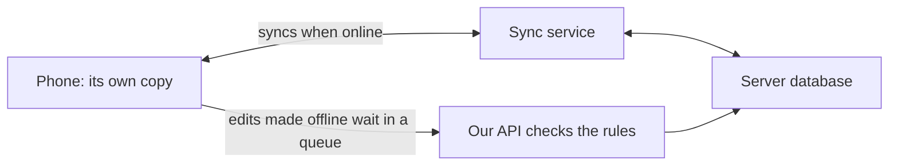

# Whenture's Foundation: How Trips Are Stored, and How the Phone Keeps Its Own Copy

Whenture is a personal travel app for two people. It tells us when to go somewhere, then helps us plan the trip. So far the only part that runs is price collection. This post is about the next layer down: the foundation that every screen will stand on.

That foundation answers three plain questions:

1. Where does a trip live, and how is it organised?
2. How does the phone keep working in a subway tunnel or on a plane?
3. Are the risky technical bets safe to build on?

The last section is blunt about what is **not** measured yet.

## Part 1: How a trip is stored

A trip is a pile of small things: days, stops, trains, bookings, costs, comments, a packing list. The server keeps each kind of thing in its own table, in a database called Postgres. A few rules keep that tidy.

**Everything belongs to a trip or to a person.** Every row says which trip it is part of, or which person it is about. That sounds dull, but it pays off twice. Any question we ask touches one trip's rows only, so it stays fast. And deciding what a phone should receive becomes simple: "send this person the rows of the trips they belong to."

**The phone can create things on its own.** Each new item gets an ID made on the device, not by the server. So you can add a stop to Tuesday while offline, and nobody has to hand it a number later.

**Money is stored as whole numbers.** Yen have no cents and pesos have two, so every amount is a whole number of the smallest unit plus a currency code. This avoids the small rounding drift that creeps in with decimals.

**Plan times and real moments are different.** "Dinner at 7 pm in Tokyo" is a local time in a place. "The flight leaves at this exact moment" is a point in time. They are stored differently on purpose, so a time zone change cannot move your dinner.

**Calculated, not stored.** Day timelines and totals are worked out from the pieces each time, by one shared set of rules. There is no second copy that can drift out of date.

**Nothing is truly deleted right away.** Removed items are marked as removed. That powers undo, and it lets a deletion travel to the phone like any other change.

There is also a hard line between two areas. The **app** area holds trips and is the part that syncs to phones. The **prices** area holds the collected price data and stays on the server. Price history is heavy and no phone needs it.

A test enforces all of this. Every table has a class (belongs to a trip, belongs to a person, or server only), and if a new table breaks the rules, the test fails.

## Part 2: Who sees what

A trip has members with roles: admin, co-admin, traveler and viewer. Passports and visas are sensitive. Only their owner and the trip's admins can see them.

The key idea is one policy, written once, that **denies by default**. If no rule says "yes", the answer is "no". The same policy is used by the server and by the sync rules, so a traveler's phone never receives what the traveler may not see. It is not hidden on screen. It is never sent.

Two details worth naming:

- A document with no owner and no trip is visible to nobody but its owner. Membership does not unlock it.
- A read-only share link is a separate kind of grant. It does not make someone a member.

## Part 3: The phone keeps its own copy

The phone is built to read from **its own database**, a small one stored on the device. It does not wait for the network to show you Tuesday's plan. In the background it syncs with the server.

The flow has two directions:

- **Down:** the sync service watches the server and sends each phone only the rows its owner may see.
- **Up:** when you edit something, the edit goes through our own API, not straight to the database. The API checks the rules (are you allowed, is it valid) before anything changes. Offline edits wait in a queue on the phone and go up when the signal returns.

Each queued edit carries a unique key. If a connection drops halfway and the phone retries, the server recognises the key and does not apply the edit twice.

For the sync engine we picked PowerSync, an open source tool that can be self-hosted. The choice came with a condition: prove it in a short test first.

## Part 4: Three spikes

A spike is a one-day experiment that answers a single question before we build on top of it. We ran three.

### Spike 1: Does sync work?

This test used simple test clients on a computer, with a connection slowed down to behave like 4G. The results, rounded:

- **First sync of a 50-stop trip:** under a third of a second at the slowest of five runs. The limit we set was two seconds.
- **An edit made offline, then reconnected:** it showed up on the second device in about a quarter of a second at the slowest of five runs. The limit was five seconds.

Both passed with plenty of room. The other checks passed too:

- Each person got exactly the rows they should, and nothing extra.
- When someone was removed from a trip, or demoted from admin, the data they could no longer see disappeared from their copy.
- Bad sign-in tokens were rejected, and good short-lived ones kept the connection up across renewals.
- An offline edit the person was not allowed to make was refused, and the phone's local copy reverted.
- Replaying an upload with the same key changed things once, not twice.

### Spike 2: Can a map work with no network?

On the web, yes. We took a map of Tokyo as a single file of about 94 MB, built from free OpenStreetMap data. A browser drew it with the network switched off, including street names, water and places. Japanese labels used the device's own fonts, so nothing had to be fetched. Ten out of ten test views rendered, with zero outside requests.

One thing to keep in mind: three cities would be roughly 300 MB. That is large for a browser to hold, so offline maps will be opt-in per trip, with the size shown first.

### Spike 3: Can we get transit times?

We wanted to check the Google routing service for a weekday 8 am train trip in Tokyo. **This one did not run.** It needs an API key tied to a billing account, and we do not have one yet. It is recorded as blocked, and no call was made. A single test call would cost nothing inside the free allowance, so this is a setup step, not a surprise bill.

## What is not done

- **The phone itself is not measured.** The sync tests used computers pretending to be phones. How much memory the app uses, how sync behaves on a real iPhone on a real network, and an edit moving between two real phones all wait for the iPhone work. The memory target is 150 MB, and we do not know yet whether we meet it.
- **The phone half of offline maps is untested.** The web test passed. How the iPhone map library stores and loads the file is still open.
- **Routing is unproven**, for the reason above.
- **The app is not hosted anywhere yet.** All of this runs on test setups.
- **Place data licensing is open.** Some providers forbid showing their data on another company's map, or saving it offline. That decides whether place pins can sit on our map.

## What this gives us

The foundation is a trip model with tested rules, a permission policy that says no by default, a sync design that passed its server-side tests with margin, and a web map that works with no network. The phone numbers and the routing answer are the honest gaps, and each has a named place where it will be closed.

Next up: showing the best time to go on the web, and then the iPhone app itself.
